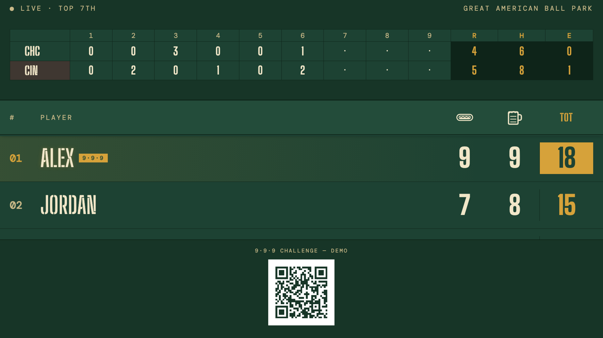
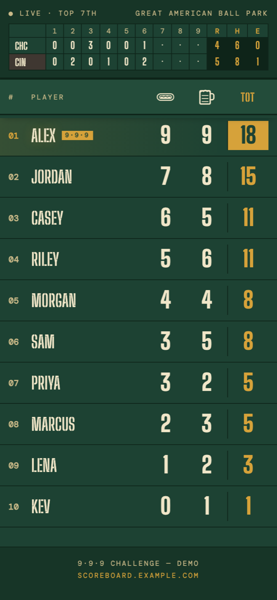

# 9·9·9 Challenge

Nine hot dogs and nine beers over nine innings of a baseball game. This repo is the live scoreboard for running one at a party.

Everyone gets an NFC tag. There are two readers, one at the hot dogs and one at the beer. Tap your tag when you grab one and the scoreboard on the TV updates right away. Guests who aren't in the room can follow along on their phones. The header shows the real game's linescore, pulled from the MLB Stats API. Anyone who hits 9 and 9 gets a celebration on every screen.

<p align="center">
  
  
</p>

## How it works

```
 NFC tag ──tap──▶ PN532 reader ──USB──▶ NFC daemon (pi/nfc)
                                             │ POST /api/tap
                                             ▼
 MLB Stats API ◀──poll── FastAPI + SQLite (pi/api) ──WebSocket──▶ TV in kiosk mode
 (ESPN fallback)                     │                          ▶ phones (via tunnel)
                                     └─ serves the built React app and /admin
```

- **`pi/api/`** — FastAPI app. It stores participants and taps in SQLite, polls the game, pushes state over a WebSocket, and serves the scoreboard and the admin page.
- **`pi/nfc/`** — reader daemon. It watches both PN532 readers and posts each tap to the API.
- **`apps/scoreboard-web/`** — the Vite + React app. `?mode=kiosk` gives the TV layout; anything else gives the phone layout.
- **`packages/scoreboard-ui/`** — the scoreboard components.
- **`pi/systemd/`**, **`pi/udev/`**, **`pi/scripts/`** — services, reader naming rules and the kiosk launcher for a Raspberry Pi.
- **`infra/cloudflared/`** — an example Cloudflare Tunnel config for putting the scoreboard on the internet.

A tag nobody has seen yet opens a "who are you?" prompt on every screen. Whoever types a name first claims the tag, and the tap that triggered it still counts.

## What you need

**Hardware**

- A Raspberry Pi with a desktop session (or any Linux box; macOS works for testing)
- Two PN532 NFC readers on USB serial. The included udev rules assume CH340 USB-serial boards; see [Reader setup](#reader-setup) if yours differ.
- One NFC tag per guest. Anything with a readable UID works: stickers, cards, wristbands.
- A TV or monitor for the kiosk

**Software**

- Python 3.12+
- Node 20+ with Corepack (provides pnpm 10)
- Chromium for the kiosk
- `cloudflared`, if guests outside your network should be able to follow along

## Configure

Everything event-specific lives in one `.env` at the repo root. The API, the Pi services and the frontend build all read it.

```bash
cp .env.example .env
```

| Variable | What it does | Default |
| --- | --- | --- |
| `MLB_TEAM_ID` | Team whose game goes in the header. IDs: `https://statsapi.mlb.com/api/v1/teams?sportId=1` | `113` (Reds) |
| `MLB_GAME_DATE` | Game date, `YYYY-MM-DD` | today |
| `DISABLE_MLB_POLLER` | `1` turns off game polling | `0` |
| `PUBLIC_URL` | Public scoreboard URL. Used in the admin QR code and allowed by CORS. | the host serving the page |
| `CORS_ALLOW_ORIGINS` | Other origins allowed to call the API, comma-separated | localhost only |
| `CHALLENGE_DB_PATH` | SQLite file | `./data/999.sqlite` |
| `SCOREBOARD_DIST_DIR` | Built frontend the API serves | `./apps/scoreboard-web/dist` |
| `CHALLENGE_LOCAL_URL` | Page the kiosk opens | `http://127.0.0.1:8001/?mode=kiosk` |
| `VITE_PUBLIC_URL` | Same as `PUBLIC_URL`, baked into the frontend: footer URL, QR code and link-preview tags | the host serving the page |
| `VITE_EVENT_LABEL` | Footer line, e.g. `9·9·9 CHALLENGE — JULY 4, 2026` | `9·9·9 CHALLENGE` |
| `VITE_API_BASE` | API origin, only when the frontend is hosted separately | same origin |

`VITE_*` values are read when you build, so run `pnpm build` again after changing them.

## Run it locally

```bash
corepack enable
pnpm install --frozen-lockfile
pnpm build

python3 -m venv .venv
. .venv/bin/activate
pip install -e './pi[dev]'

uvicorn pi.api.main:app --port 8001
```

Then open:

- Scoreboard: http://127.0.0.1:8001/
- Kiosk layout: http://127.0.0.1:8001/?mode=kiosk
- Admin: http://127.0.0.1:8001/admin

No readers? Fake a tap:

```bash
curl -X POST http://127.0.0.1:8001/api/tap \
  -H 'Content-Type: application/json' \
  -d '{"uid":"TEST-TAG","station":"hotdog"}'
```

`./scripts/local-rehearsal.sh up` builds everything and starts the API with polling off. Run `./scripts/local-rehearsal.sh seed` in a second terminal to load demo players and taps.

**On a Mac with real readers**, `./scripts/local-mac.sh` handles setup, finds USB-serial readers and runs the API, kiosk and NFC daemon together:

```bash
./scripts/local-mac.sh setup
./scripts/local-mac.sh readers        # list connected readers
./scripts/local-mac.sh run --with-kiosk --with-nfc \
  --hotdog-device /dev/cu.usbserial-XXXX --beer-device /dev/cu.usbserial-YYYY
```

## Set up the Raspberry Pi

1. Clone the repo, create `.env`, and run the install and build steps from [Run it locally](#run-it-locally). Put the venv at `.venv` in the repo, because the services look for it there.
2. Name the readers (next section).
3. Install the services. The script fills in your user, home directory and repo path:

   ```bash
   sudo ./pi/scripts/install-services.sh          # api, nfc, kiosk
   sudo systemctl enable --now 999-api 999-nfc
   sudo systemctl enable --now 999-kiosk          # once the desktop session is up
   curl http://127.0.0.1:8001/api/state           # smoke test
   ```

The API listens on port `8001` on all interfaces, so phones on the same Wi-Fi can open `http://<pi-ip>:8001/`.

### Reader setup

The daemon expects the readers at `/dev/nfc-hotdog` and `/dev/nfc-beer`. The udev rules in `pi/udev/99-pn532.rules` create those names from the USB port each reader is plugged into, so a reboot can't swap them.

```bash
udevadm info -a -n /dev/ttyUSB0 | grep -E 'devpath|idVendor|idProduct'
udevadm info -a -n /dev/ttyUSB1 | grep -E 'devpath|idVendor|idProduct'
```

Edit the rules with your values: which `devpath` is the hot dog reader, which is the beer reader, and your vendor/product IDs if they aren't CH340's `1a86:7523`. Then:

```bash
sudo cp pi/udev/99-pn532.rules /etc/udev/rules.d/
sudo udevadm control --reload-rules && sudo udevadm trigger
ls -la /dev/nfc-hotdog /dev/nfc-beer
```

Readers somewhere else? Pass nfcpy connection strings to the daemon with `--hotdog-device` and `--beer-device`.

## Let remote guests follow along

The API serves the frontend, so publishing port 8001 is all it takes. A Cloudflare Tunnel does that without opening ports on your router:

```bash
cp infra/cloudflared/config.example.yml infra/cloudflared/config.yml
cloudflared tunnel create 999-challenge
# edit config.yml: credentials-file path and your hostname
cloudflared tunnel route dns 999-challenge scoreboard.example.com
sudo ./pi/scripts/install-services.sh tunnel
sudo systemctl enable --now 999-tunnel
```

The example config blocks `/admin` and `/api/admin` on the public hostname, so only people on your network can reach the admin page. Set `PUBLIC_URL` and `VITE_PUBLIC_URL` to the public hostname and rebuild, so the QR code points to it.

For a quick test with no DNS setup, run `cloudflared tunnel --url http://localhost:8001`.

To host the frontend on its own (Cloudflare Pages, for example; `infra/deploy/cloudflare-pages.toml` has the build settings), set `VITE_API_BASE` to the API's public origin and add the frontend's origin to `CORS_ALLOW_ORIGINS`.

## Game day

The admin page (`/admin`, local network only) lets you:

- Add, rename or remove participants, or assign a tag to someone by hand
- Pin the linescore manually if the MLB feed acts up, then hand control back to the feed
- Show a full-screen QR code so guests can join on their phones
- Archive the night's database to `archive/` and reset for the next event

The reader pills in the header turn red when a reader has been quiet for more than a minute.

## Tests

```bash
pnpm typecheck
pnpm test                                        # component + snapshot tests
pnpm --filter @challenge/scoreboard-web test:e2e # Playwright smoke test
python -m pytest pi/api/tests pi/tests
```

pnpm can't run scripts from a folder whose path contains `:`. Clone into a path without one.

## License

[MIT](LICENSE)
